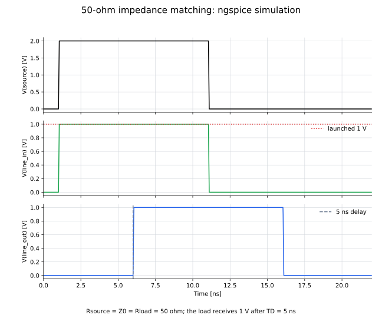

# 02: 50 Ωインピーダンス整合

信号源、伝送線路、負荷をすべて50 Ωにそろえ、負荷端で反射が生じない条件を確認します。

## ファイル

- `02_impedance_matching.cir`：損失のない伝送線路を使ったngspiceモデル
- `draw_02_impedance_matching.py`：回路図を生成するコード
- `02_impedance_matching_circuit.svg`：信号源、伝送線路、負荷の接続図
- `plot_02_impedance_matching.py`：各ノードの過渡応答を描画するコード
- `02_impedance_matching.svg`：入力端と負荷端の電圧

## 回路図


## 回路の説明

- 入力：`Vin`が生成する2 V、幅10 nsの電圧パルス
- 信号源インピーダンス：`Rsource = 50 Ω`
- 伝送線路：特性インピーダンス`Z0 = 50 Ω`、伝搬遅延`TD = 5 ns`
- 負荷：`Rload = 50 Ω`
- 観測ノード：伝送線路入力`line_in`と負荷端`line_out`

信号源抵抗と伝送線路の分圧により、線路へ進む電圧は

$$
V^+=V_{\mathrm{in}}\frac{Z_0}{R_{\mathrm{source}}+Z_0}
=2\ \mathrm{V}\times\frac{50}{50+50}=1\ \mathrm{V}
$$

です。負荷端の電圧反射係数は

$$
\Gamma_L=\frac{R_{\mathrm{load}}-Z_0}{R_{\mathrm{load}}+Z_0}
$$

であり、`Rload = Z0 = 50 Ω`では $\Gamma_L=0$ となるため反射しません。

信号源側についても

$$
\Gamma_S=\frac{R_{\mathrm{source}}-Z_0}{R_{\mathrm{source}}+Z_0}=0
$$

なので、信号源へ戻った波がある場合も再反射せず吸収されます。

| 負荷 | $\Gamma_L$ | 入射波に対する負荷端電圧 |
|---:|---:|---:|
| 25 Ω | $-1/3$ | $2/3$ |
| 50 Ω | 0 | 1 |
| 100 Ω | $+1/3$ | $4/3$ |
| 開放 | $+1$ | 2 |

この表の負荷端電圧は、到来した入射波を1とした比です。

## 各ノードの過渡応答



`line_in`には約1 nsで1 Vが現れ、`line_out`には伝搬遅延5 ns後の約6 nsで同じ1 Vが現れます。現在のモデルは損失のない理想伝送線路なので、振幅減衰や分散は含みません。

## 実行方法

```bash
python circuits/02_impedance_matching/draw_02_impedance_matching.py
python circuits/02_impedance_matching/plot_02_impedance_matching.py
ngspice -b circuits/02_impedance_matching/02_impedance_matching.cir
```
