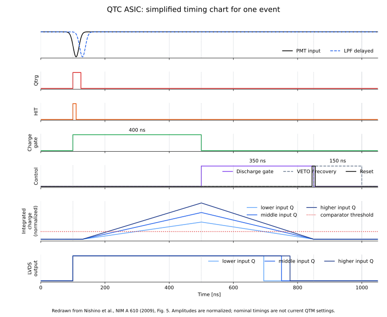

# 02: QTCタイミング概要

QTCの1イベントにおける、検出、電荷積分、定電流放電、回復の順序を示す概念図です。

## ファイル

- `draw_02_qtc_timing.py`：タイミングチャートを生成するコード
- `02_qtc_timing.svg`：生成したタイミングチャート

## タイミングチャート



## 入力信号と出力信号

- 入力：PMTから到来する負極性パルス`PMT input`
- 遅延信号：LPF通過後の`LPF delayed`
- 内部制御：`Qtrg`、`HIT`、`Charge gate`、`Discharge gate`、`Reset`、`VETO / recovery`
- 出力：入力電荷に応じた幅を持つ`LVDS output`

PMT入力を検出すると、QTCは積分期間と放電期間を順番に作ります。積分された電荷が一定電流でしきい値まで放電される時間が、LVDS出力のパルス幅に反映されます。

1. 入力パルスを検出して`HIT`と`Qtrg`を生成する。
2. `Charge gate`中に入力電荷を積分する。
3. `Discharge gate`中に一定電流で放電する。
4. 積分ノードがしきい値へ戻った時刻で出力パルスを終了する。
5. VETO／回復期間を経て次のイベントを受け付ける。

図ではCharge gateを400 ns、Discharge gateを350 ns、VETO／回復期間を150 nsとして表示しています。入力電荷が大きいほど、一定電流でしきい値まで戻る時間とLVDS出力幅が長くなります。

振幅は規格化しており、図中のLPF遅延や波形形状は実機で検証した値ではありません。

## 生成方法

```bash
python circuits/02_qtc_timing/draw_02_qtc_timing.py
```
