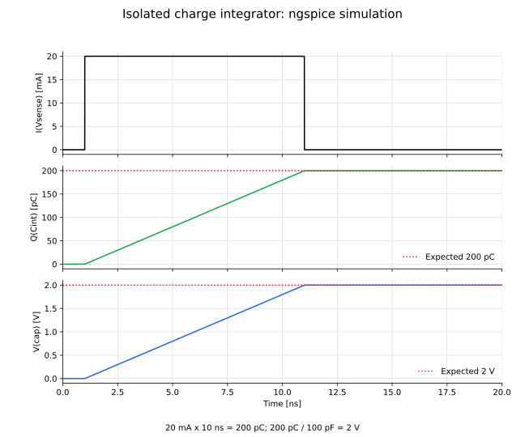

# 03: 電荷積分回路

入力電流をコンデンサに蓄積し、入力電荷を`cap`ノードの電位へ変換する単純化モデルです。

## ファイル

- `03_integrator_only.cir`：ngspiceモデル
- `draw_03_integrator_only.py`：回路図を生成するコード
- `03_integrator_only.svg`：生成した回路図
- `plot_03_integrator.py`：過渡応答を計算して描画するコード
- `03_integrator.svg`：入力電流、蓄積電荷、`cap`ノード電位

## 回路図


## 回路の説明

- 入力：電流源`Iinput`が生成する、0 mAから20 mAへ立ち上がる幅10 nsのパルス
- 電流観測：0 Vの電圧源`Vsense`を流れる電流`I(Vsense)`
- 積分素子：`Cint = 100 pF`
- 漏れ経路：`Rleak = 1 TΩ`
- 出力：`cap`ノードの電位`V(cap)`と、コンデンサの蓄積電荷`Q(Cint)`

入力電流は1 nsに流れ始め、11 nsに停止します。入力中は`Cint`へ電荷が蓄積され、`V(cap)`が直線的に上昇します。入力停止後は、蓄積電荷が`Rleak`を通じて時定数100 sで減少します。

## 各信号の過渡応答



`I(Vsense)`がコンデンサへ流れ込むと、蓄積電荷と`cap`ノードの電位は

$$
Q(t)=\int_{t_0}^{t} I(Vsense)(t')\,dt',
\qquad
V(cap)=\frac{Q(t)}{C_{\mathrm{int}}}
$$

に従います。一定電流を入力している間の傾きは

$$
\frac{dV(cap)}{dt}=\frac{I_{\mathrm{in}}}{C_{\mathrm{int}}}
=\frac{20\ \mathrm{mA}}{100\ \mathrm{pF}}
=0.2\ \mathrm{V/ns}
$$

です。

## ノードと時間関係

| 信号 | 1 nsより前 | 1--11 ns | 11 ns以後 |
|---|---:|---:|---:|
| `I(Vsense)` | 0 mA | 20 mA | 0 mA |
| `Q(Cint)` | 0 pC | 0 → 200 pC | 約200 pCを保持 |
| `V(cap)` | 0 V | 0 → 2 V | 約2 Vを保持 |

理想モデルでは、入力開始から積分開始までの伝搬遅延はありません。ただし、電流の矩形波が電圧のランプ波へ変わるため、両者を単純な時間シフトとしては表せません。

漏れ抵抗を含む小信号の周波数応答は

$$
\frac{V(cap)}{I_{\mathrm{in}}}
=\frac{R_{\mathrm{leak}}}{1+j\omega R_{\mathrm{leak}}C_{\mathrm{int}}},
\qquad
\phi(\omega)=-\tan^{-1}(\omega R_{\mathrm{leak}}C_{\mathrm{int}})
$$

です。高周波側では電圧が電流より約90°遅れます。現在の値では、

$$
\tau=R_{\mathrm{leak}}C_{\mathrm{int}}
=1\ \mathrm{T\Omega}\times100\ \mathrm{pF}=100\ \mathrm{s}
$$

なので、20 nsの表示範囲では漏れによる電圧低下はほぼ見えません。

## 実行方法

```bash
python circuits/03_integrator/draw_03_integrator_only.py
python circuits/03_integrator/plot_03_integrator.py
ngspice -b circuits/03_integrator/03_integrator_only.cir
```
