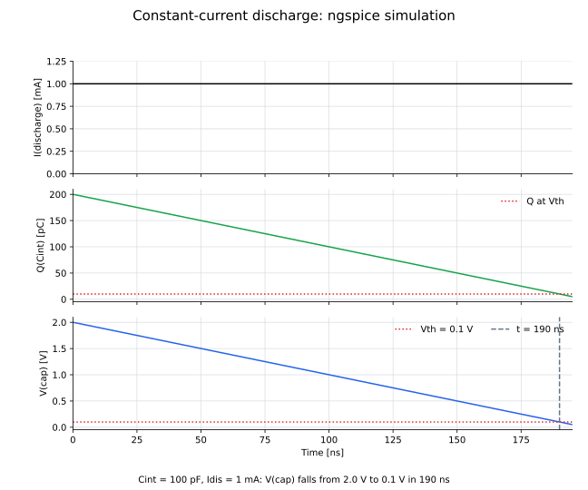

# 04: 定電流放電

100 pFのコンデンサを2 Vに初期化し、1 mAの一定電流で放電する単純化モデルです。

## ファイル

- `04_discharge_only.cir`：ngspiceモデル
- `draw_04_discharge.py`：回路図を生成するコード
- `04_discharge_circuit.svg`：定電流放電回路
- `plot_04_discharge.py`：過渡応答を計算して描画するコード
- `04_discharge.svg`：放電電流、残留電荷、`cap`ノード電位

## 回路図


## 各信号の過渡応答



## 回路の説明

- 入力状態：`Cint = 100 pF`を2 V、すなわち200 pCに初期化
- 放電入力：`cap`ノードからGNDへ流れる`Idis = 1 mA`の定電流
- 判定基準：`Vth = 0.1 V`
- 出力・観測量：残留電荷`Q(Cint)`、`cap`ノードの電位`V(cap)`、しきい値到達時刻

放電電流が一定なので、コンデンサの電荷と`V(cap)`は時間に比例して減少します。この回路では、放電開始から`V(cap)`がしきい値へ達するまでの時間が電荷に対応します。

`cap`ノードを一定電流で放電すると、

$$
V(cap,t)=V_0-\frac{I_{\mathrm{dis}}}{C_{\mathrm{int}}}t,
\qquad
Q(C_{\mathrm{int}},t)=C_{\mathrm{int}}V(cap,t)
$$

となります。電圧の傾きは

$$
\frac{dV(cap)}{dt}=-\frac{1\ \mathrm{mA}}{100\ \mathrm{pF}}
=-0.01\ \mathrm{V/ns}
$$

です。2 Vからしきい値0.1 Vへ到達する時間は

$$
t_{\mathrm{dis}}
=\frac{C_{\mathrm{int}}(V_0-V_{\mathrm{th}})}{I_{\mathrm{dis}}}
=\frac{100\ \mathrm{pF}\,(2.0-0.1)\ \mathrm{V}}{1\ \mathrm{mA}}
=190\ \mathrm{ns}
$$

です。

## ノードと時間関係

| 時刻 | `I(discharge)` | `Q(Cint)` | `V(cap)` |
|---:|---:|---:|---:|
| 0 ns | 1 mA | 200 pC | 2.0 V |
| 100 ns | 1 mA | 100 pC | 1.0 V |
| 190 ns | 1 mA | 10 pC | 0.1 V |

この回路では固定の位相差ではなく、初期電荷に比例するしきい値到達時間を観測します。

## 実行方法

```bash
python circuits/04_discharge/draw_04_discharge.py
python circuits/04_discharge/plot_04_discharge.py
ngspice -b circuits/04_discharge/04_discharge_only.cir
```
