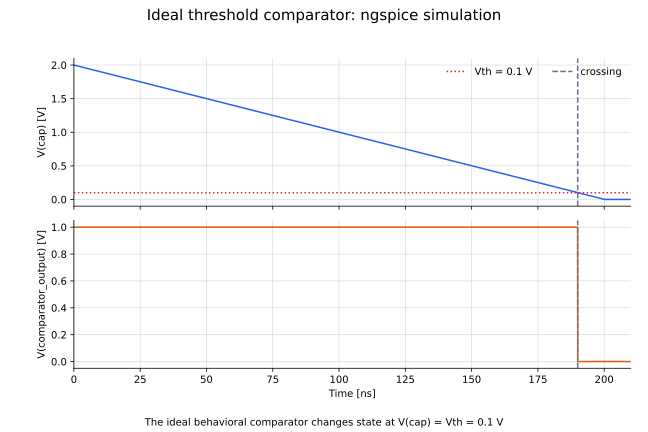

# 05: しきい値比較器

低下する`cap`ノードの電位を0.1 Vのしきい値と比較し、論理レベルへ変換する理想比較器モデルです。

## ファイル

- `05_comparator_only.cir`：ngspiceモデル
- `plot_05_comparator.py`：各ノードの過渡応答を描画するコード
- `05_comparator.svg`：入力・出力ノード電位

## 各ノードの過渡応答



## 回路の説明

- 入力：`Vramp`が生成する、0 nsの2 Vから200 nsの0 Vまで低下する`V(cap)`
- 比較基準：`Vth = 0.1 V`
- 比較器：条件式`V(cap) > Vth`を評価する`Boutput`
- 出力：1 Vまたは0 Vを取る`V(comparator_output)`

入力がしきい値より高い間は出力が1 Vになり、入力がしきい値以下になると0 Vへ切り替わります。

理想比較器の出力は

$$
V(\mathrm{comparator\_output})=
\begin{cases}
1\ \mathrm{V} & V(cap)>V_{\mathrm{th}},\\
0\ \mathrm{V} & V(cap)\le V_{\mathrm{th}}
\end{cases}
$$

としています。`V(cap)`は0 nsの2 Vから200 nsの0 Vまで直線的に低下するため、0.1 Vを通過する時刻は190 nsです。

## ノードと時間関係

| 時刻 | `V(cap)` | `V(comparator_output)` |
|---:|---:|---:|
| 0 ns | 2.0 V | 1 V |
| 190 ns直前 | 0.1 Vより大きい | 1 V |
| 190 ns以後 | 0.1 V以下 | 0 V |

現在の理想モデルでは比較器の伝搬遅延を0としているため、`V(cap)`のしきい値通過と`V(comparator_output)`の立ち下がりは同時です。実デバイスでは伝搬遅延 $t_{pd}$ と立ち上がり・立ち下がり時間を別途加える必要があります。

## 実行方法

```bash
python circuits/05_comparator/plot_05_comparator.py
ngspice -b circuits/05_comparator/05_comparator_only.cir
```
