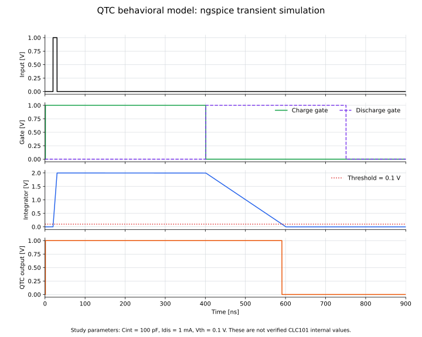

# 06: QTC機能モデル

50 Ω入力、Charge gate、電荷積分、定電流放電、しきい値判定を接続した、1チャンネル・1レンジのQTC機能モデルです。

## ファイル

- `06_qtc_behavioral.cir`：ngspice機能モデル
- `draw_06_qtc_behavioral.py`：回路図を生成するコード
- `06_qtc_behavioral_circuit.svg`：入力からQTC出力までの接続図
- `plot_06_qtc_simulation.py`：各ノードの過渡応答を描画するコード
- `06_qtc_simulation.svg`：生成したタイミングチャート

## 回路図


## 各ノードの過渡応答



## 回路の説明

- 信号入力：`Vin`が生成する、20 nsに立ち上がる1 V、幅10 nsのパルス
- 入力終端：`Rterm = 50 Ω`。入力中は20 mAが積分部へ渡る
- 積分制御：1--401 nsで有効になる`charge_gate`
- 放電制御：約401--751 nsで有効になる`discharge_gate`
- 積分ノード：`Cint = 100 pF`を接続した`cap`
- 放電電流：`Idis = 1 mA`
- 比較基準：`Vth = 0.1 V`
- 出力：`charge_gate`が有効、または`V(cap) > Vth`の間に1 Vとなる`qtc_output`

入力パルスは50 Ω終端で電流へ変換され、Charge gate中に`Cint`へ蓄積されます。Charge gate終了後は一定電流で放電し、`V(cap)`がしきい値へ到達すると`qtc_output`が0 Vへ戻ります。

`charge_gate`は1 nsに立ち上がり、20--30 nsの入力パルスを積分します。入力電荷は

$$
Q_{\mathrm{in}}
=\int\frac{V(input,t)}{R_{\mathrm{term}}}\,dt
=\frac{1\ \mathrm{V}}{50\ \Omega}\times10\ \mathrm{ns}
=200\ \mathrm{pC}
$$

です。`discharge_gate`は約401 nsに立ち上がり、`cap`ノードを一定電流で放電します。比較器が反転するまでの放電時間は

$$
t_{\mathrm{dis}}
=\frac{Q_{\mathrm{in}}-C_{\mathrm{int}}V_{\mathrm{th}}}{I_{\mathrm{dis}}}
$$

です。現在の値では $C_{\mathrm{int}}V_{\mathrm{th}}=10\ \mathrm{pC}$ なので、

$$
t_{\mathrm{dis}}
=\frac{200\ \mathrm{pC}-10\ \mathrm{pC}}{1\ \mathrm{mA}}
=190\ \mathrm{ns}
$$

となります。

## ノードと時間関係

| 時刻 | `V(input)` | `V(charge_gate)` | `V(discharge_gate)` | `V(cap)` | `V(qtc_output)` |
|---:|---:|---:|---:|---:|---:|
| 1 ns | 0 V | 1 V | 0 V | 0 V | 1 V |
| 20--30 ns | 1 V | 1 V | 0 V | 0 → 2 V | 1 V |
| 約401 ns | 0 V | 0 V | 1 V | 2 Vから放電開始 | 1 V |
| 約591 ns | 0 V | 0 V | 1 V | 0.1 V | 0 V |

QTC出力幅は、400 nsのCharge gateと190 nsの放電時間の和として

$$
t_{\mathrm{out}}=400\ \mathrm{ns}+190\ \mathrm{ns}=590\ \mathrm{ns}
$$

になります。ここで使う`Cint`、`Idis`、`Vth`は検討用パラメータであり、実際のCLC101内部値として確認されたものではありません。

## 実行方法

```bash
python circuits/06_qtc_behavioral/draw_06_qtc_behavioral.py
python circuits/06_qtc_behavioral/plot_06_qtc_simulation.py
ngspice -b circuits/06_qtc_behavioral/06_qtc_behavioral.cir
```
