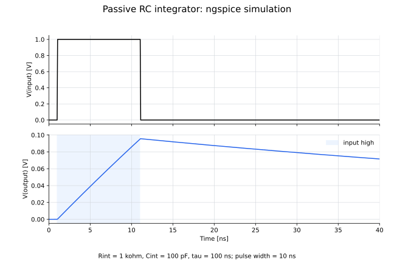

# 07: RC積分回路

抵抗を直列、コンデンサを並列に接続し、コンデンサ両端の電圧を出力とする受動RC積分回路です。

## ファイル

- `07_rc_integrator.cir`：ngspiceモデル
- `draw_07_rc_integrator.py`：回路図を生成するコード
- `07_rc_integrator_circuit.svg`：RC積分回路
- `plot_07_rc_integrator.py`：入力・出力電圧を描画するコード
- `07_rc_integrator.svg`：ngspiceによる過渡応答

## 回路図


## 回路の説明

- 入力：`Vin`が生成する1 V、幅10 nsの電圧パルス
- 直列抵抗：`Rint = 1 kΩ`
- 並列容量：`Cint = 100 pF`
- 出力：コンデンサ両端の`V(output)`
- 時定数：$\tau=R_{\mathrm{int}}C_{\mathrm{int}}=100\ \mathrm{ns}$

回路方程式は

$$
R_{\mathrm{int}}C_{\mathrm{int}}\frac{dV_{\mathrm{out}}}{dt}
+V_{\mathrm{out}}=V_{\mathrm{in}}
$$

です。入力が変化する時間より時定数が十分長い場合、

$$
V_{\mathrm{out}}(t)
\simeq\frac{1}{R_{\mathrm{int}}C_{\mathrm{int}}}
\int V_{\mathrm{in}}(t)\,dt
$$

となります。現在はパルス幅10 nsに対して時定数100 nsなので、入力がHighの間に出力が約0.095 Vまで増加します。

伝達関数と位相は

$$
H(j\omega)=\frac{1}{1+j\omega R_{\mathrm{int}}C_{\mathrm{int}}},
\qquad
\phi=-\tan^{-1}(\omega R_{\mathrm{int}}C_{\mathrm{int}})
$$

です。$\omega RC\gg1$では積分動作に近づき、出力は入力より約90°遅れます。

## 各ノードの過渡応答



入力の立ち上がりと同時に出力は増加を始めますが、矩形波はランプ状に変わるため、固定時間だけ遅れた波形ではありません。入力が0 Vへ戻ると、コンデンサは`Rint`を通じて指数関数的に放電します。

## 実行方法

```bash
python circuits/07_rc_integrator/draw_07_rc_integrator.py
python circuits/07_rc_integrator/plot_07_rc_integrator.py
ngspice -b circuits/07_rc_integrator/07_rc_integrator.cir
```
