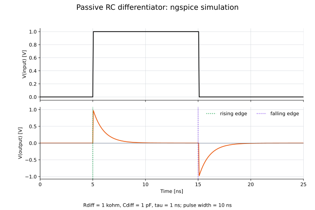

# 08: RC微分回路

コンデンサを直列、抵抗を並列に接続し、抵抗両端の電圧を出力とする受動RC微分回路です。

## ファイル

- `08_rc_differentiator.cir`：ngspiceモデル
- `draw_08_rc_differentiator.py`：回路図を生成するコード
- `08_rc_differentiator_circuit.svg`：RC微分回路
- `plot_08_rc_differentiator.py`：入力・出力電圧を描画するコード
- `08_rc_differentiator.svg`：ngspiceによる過渡応答

## 回路図


## 回路の説明

- 入力：`Vin`が生成する1 V、幅10 nsの電圧パルス
- 直列容量：`Cdiff = 1 pF`
- 並列抵抗：`Rdiff = 1 kΩ`
- 出力：抵抗両端の`V(output)`
- 時定数：$\tau=R_{\mathrm{diff}}C_{\mathrm{diff}}=1\ \mathrm{ns}$

伝達関数は

$$
H(j\omega)=\frac{j\omega R_{\mathrm{diff}}C_{\mathrm{diff}}}
{1+j\omega R_{\mathrm{diff}}C_{\mathrm{diff}}}
$$

です。$\omega RC\ll1$では、

$$
V_{\mathrm{out}}(t)
\simeq R_{\mathrm{diff}}C_{\mathrm{diff}}
\frac{dV_{\mathrm{in}}}{dt}
$$

となります。この領域の位相は約+90°で、出力が入力より進みます。

入力が上昇すると正のパルス、低下すると負のパルスが出力されます。大きさ$\Delta V$の理想ステップに対する応答は、各エッジを起点として

$$
V_{\mathrm{out}}(t)=\pm\Delta V\exp\left(-\frac{t}{RC}\right)
$$

と減衰します。

## 各ノードの過渡応答



現在の立ち上がり・立ち下がり時間は50 psです。シミュレーションでは、5 nsの立ち上がりに約+0.975 V、15 nsの立ち下がりに約−0.975 Vの出力が生じます。

## 実行方法

```bash
python circuits/08_rc_differentiator/draw_08_rc_differentiator.py
python circuits/08_rc_differentiator/plot_08_rc_differentiator.py
ngspice -b circuits/08_rc_differentiator/08_rc_differentiator.cir
```
